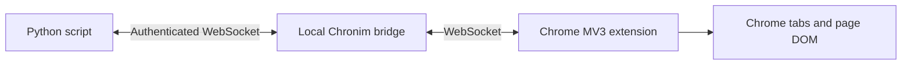
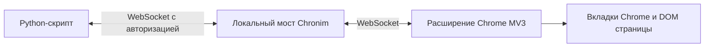

#  Сhronim 

**Control your browser. Directly from Python.**

Chronim is a Python library for controlling Google Chrome through a local, authenticated WebSocket bridge and a Manifest V3 Chrome extension. It gives Python scripts a small API for navigation, tabs, page elements, keyboard and pointer events, screenshots, and page JavaScript.

> **Quick links:** [English](#english) · [Русский](#русский) · [Installation](#installation) · [API reference](#api-reference) · [Установка](#установка) · [Справочник-api](#справочник-api)

---

## English

### What Chronim does

Chronim lets a Python program send commands to Chrome without Selenium, Playwright, or Puppeteer. A small extension runs in Chrome; a Python bridge listens only on loopback (`127.0.0.1`) and routes authenticated commands to that extension.



The bridge starts automatically when your program calls `chronim.connect()` or `await chronim.connect_async()`. The extension reconnects when the bridge becomes available. Keep the Python program running while you automate Chrome.

### Features

- Navigate the active tab, move through history, reload, and read its title or URL.
- Create, close, activate, and inspect tabs.
- Find page elements with CSS selectors, click them, read text and attributes, and edit form fields.
- Wait for elements and page load completion.
- Wait for selector states (`attached`, `detached`, `visible`, or `hidden`), optionally until text appears.
- Auto-wait before clicking until the target is visible, enabled, stable, and receives pointer events.
- Dispatch keyboard and pointer events.
- Send trusted mouse clicks and text input through Chrome DevTools Protocol.
- Capture a screenshot as a PNG data URL or save it directly to a file.
- Target a tab by ID without switching Chrome's active tab.
- Run JavaScript in the active page's main world.
- Use synchronous or `asyncio` APIs.
- Authenticate both the Python client and extension with a random per-user API key.

### Requirements

- Python 3.10 or newer.
- Google Chrome with Manifest V3 extension support.
- A local installation of the Chronim extension.
- The `websockets` Python dependency, installed automatically by pip.

### Install Chronim from PyPI

```bash
python -m pip install --upgrade chronim
```

Check which package Python imported and locate the bundled extension:

```bash
python -c "import chronim; print(chronim.__version__); print(chronim.__file__); print(chronim.extension_path())"
```

`chronim.extension_path()` prints the directory Chrome needs for **Load unpacked**. Run this command from outside a source checkout when you want to verify the PyPI installation rather than a local project copy.

### Install the Chrome extension

1. Run the command above and copy the printed extension directory.
2. Open `chrome://extensions` in Chrome.
3. Turn on **Developer mode**.
4. Click **Load unpacked** and select the extension directory.
5. Pin Chronim from Chrome's Extensions menu if you want the toolbar button to stay visible.

The extension requests `tabs`, `activeTab`, `scripting`, `storage`, and `debugger`, and host access to HTTP and HTTPS pages so it can control their tabs and DOM. Chrome displays an additional warning for the `debugger` permission; it is used only by `trusted_click()` and `trusted_type()`. Chrome internal pages and the Chrome Web Store do not allow normal extension automation.

### Connect the extension to Python

The API key must be the same in Python and in the extension. To create or read the key saved for the current Windows user, run:

```bash
python -c "import chronim; print(chronim.get_api_key())"
```

Then open the Chronim toolbar popup, expand **Connection settings**, paste the key, and select **Save and connect**. The key is stored in the extension's local storage and in the user's Chronim configuration directory. Do not paste it into source control, issue trackers, screenshots, or chat messages.

`get_api_key()` only reads or creates the key; it does **not** start the bridge. The bridge starts when a script calls `connect()` or `connect_async()`. Save the key first, then run an automation script and leave it running while the extension is connected.

On Windows, a key generated with `get_api_key()` is stored under `%APPDATA%\chronim\config.json`. On other systems it is stored under `~/.config/chronim/config.json`. If `CHRONIM_API_KEY` is set, it overrides the file; the popup must then contain that environment key. If you use a custom `port`, set the same port in the popup.

### First script

Save as `quickstart.py`:

```python
import chronim

browser = chronim.connect()
try:
    browser.open("https://example.com")
    browser.wait_for_load()

    print("Title:", browser.title())
    print("URL:", browser.url())
    print("Heading:", browser.get_text("h1"))
finally:
    browser.disconnect()
```

Run it with `python quickstart.py`. The first call starts the local bridge. The extension popup should show **Connected** while the script is running.

### Async example

```python
import asyncio
import chronim

async def main():
    browser = await chronim.connect_async()
    try:
        await browser.open("https://example.com")
        await browser.wait_for_load()
        print(await browser.title())
        print(await browser.get_text("h1"))
    finally:
        await browser.disconnect()

asyncio.run(main())
```

The sync and async interfaces use the same bridge and command protocol. Do not call the blocking sync API from an active asyncio event loop; use `connect_async()` there.

### Common tasks

#### Search a page

```python
import chronim

browser = chronim.connect()
try:
    browser.open("https://www.google.com")
    browser.wait_for_load()
    browser.type("textarea[name=q]", "Chronim Python Chrome")
    browser.press("ENTER")
    browser.wait_for_load()
    print(browser.title())
finally:
    browser.disconnect()
```

#### Work with tabs

```python
browser = chronim.connect()
try:
    new_tab = browser.new_tab("https://example.com")
    browser.wait_for_load()
    print("New tab:", new_tab)
    print("All tabs:", browser.get_tabs())
    print("Active tab:", browser.active_tab())
finally:
    browser.disconnect()
```

Tab metadata is returned as dictionaries containing fields such as `id`, `url`, `title`, `active`, and `window_id`. `find()` and `find_all()` return element descriptions; they are not persistent element handles.

#### Capture a screenshot

```python
image_data_url = browser.screenshot()
print(image_data_url[:30])  # data:image/png;base64,...

saved_path = browser.screenshot("artifacts/page.png")
print("Saved:", saved_path)
```

Without a path, the result is a PNG data URL. With a path, Chronim writes the PNG file and returns its resolved path. Chrome can capture only the active visible tab; a tab-scoped browser cannot capture a background tab.

#### Target a tab without switching focus

```python
browser = chronim.connect()
try:
    tabs = browser.get_tabs()
    background_tab = next(tab for tab in tabs if not tab["active"] and tab["url"].startswith("https://"))
    page = browser.on_tab(background_tab["id"])
    print(page.title(), page.url())
    print(page.get_text("h1"))
finally:
    browser.disconnect()
```

The scoped object shares the same connection. Most navigation and page commands target the chosen tab without activating it. Screenshots still require the target tab to be visible and active.

#### Wait for the right element state

```python
browser.wait_for_element("#results", timeout=10, state="visible")
browser.wait_for_element(".loading", timeout=10, state="hidden")
browser.wait_for_element("#status", timeout=10, text="Ready")
browser.click("button[type=submit]", timeout=10)
```

`wait_for_element()` supports `attached`, `detached`, `visible`, and `hidden`. The optional `text` value waits for that text to appear inside the selected element. `click()` waits for visibility, enabled state, a stable bounding box, and an unobstructed center point before clicking.

#### Send trusted browser input

```python
browser.trusted_click(420, 280)  # viewport coordinates in CSS pixels
browser.trusted_type("Hello from Chronim")  # types into the currently focused field
```

These two methods use Chrome DevTools Protocol input events. `trusted_type()` does not locate or focus a field; focus it first with `click()` or a page action. Chrome may prevent debugger attachment while DevTools is attached to the same tab.

#### Run page JavaScript

```python
title = browser.execute_js("document.title")
print(title)
```

JavaScript runs in the active page's main world. It has page privileges only; it does not expose Python, Node.js, the operating system, or the local filesystem. Chrome applies the page's Content Security Policy, so some pages reject dynamic evaluation. Return values must be serializable by Chrome's extension messaging APIs.

#### Read and change live page code

Chronim can inspect the current DOM and CSS without writing JavaScript yourself. `page_source()` returns the live document markup after the page has rendered and scripts have run; it is not necessarily the original HTML response. `get_computed_style()` reads the browser's resolved CSS values, and `set_style()` changes an element's inline CSS style for the current page session.

```python
html = browser.page_source()
print(html[:500])

color = browser.get_computed_style("h1", "color")
all_styles = browser.get_computed_style("h1")
print("Heading color:", color)

browser.set_style("h1", "color", "tomato")
browser.set_style("h1", "font-size", "48px")
```

CSS properties may use either browser-style names such as `"background-color"` or custom properties such as `"--brand-color"`. If no property is passed to `get_computed_style()`, it returns a dictionary of computed property names and values. Style changes affect the current page and may be replaced by the site's own scripts or a later navigation.

### API reference

`chronim.connect(*, api_key=None, host="127.0.0.1", port=8765, timeout=15)` returns a synchronous `Browser`. `await chronim.connect_async(...)` returns an `AsyncBrowser`. All browser operations below have matching async methods unless marked otherwise.

| Method | What it does | Return value |
|---|---|---|
| `open(url)` | Navigate the active tab. The browser extension accepts HTTP and HTTPS URLs. | Operation result |
| `back()`, `forward()`, `refresh()` | Navigate browser history or reload the active tab. | Operation result |
| `title()`, `url()` | Read the active tab's title or URL. | String |
| `wait_for_load(timeout=30)` | Wait for the active tab to finish loading. | `True` |
| `sleep(seconds)` | Wait for a bounded delay. | `True` |
| `screenshot(path=None)` | Capture the visible area; optionally save the PNG to a file. | PNG data URL or resolved file path |
| `execute_js(code)` | Evaluate code in the active page's main world. | Serializable result |
| `page_source()` | Read the current live document markup. | HTML string |
| `click(selector, timeout=10)` | Wait for the first matching CSS element to be actionable, then click it. | `True` |
| `type(selector, text)` | Replace a field's value and dispatch input/change events. | `True` |
| `clear(selector)` | Clear an input or editable element. | `True` |
| `get_text(selector)` | Read visible text or text content. | String |
| `get_attribute(selector, attribute)` | Read one HTML attribute. | String or `None` |
| `get_html(selector)` | Read the element's inner HTML. | String |
| `get_computed_style(selector, property=None)` | Read one computed CSS property, or all computed styles when omitted. | String or dictionary |
| `set_style(selector, property, value)` | Set an element's inline CSS property for the current page session. | `True` |
| `find(selector)`, `find_all(selector)` | Describe the first or all matching elements. | Dictionary or list of dictionaries |
| `exists(selector)` | Check whether a matching element exists. | Boolean |
| `wait_for_element(selector, timeout=10, state="attached", text=None)` | Wait for an element state and optionally for text. States: `attached`, `detached`, `visible`, `hidden`. | Element description or `True` |
| `press(key)` | Dispatch keyboard events for one key. | `True` |
| `hotkey(*keys)` | Dispatch a key combination, such as `hotkey("CTRL", "A")`. | `True` |
| `scroll(x=0, y=0)` | Scroll the page by pixel offsets. | Scroll position |
| `move(x, y)` | Dispatch a pointer-move event at viewport coordinates. | `True` |
| `trusted_click(x, y)` | Send a trusted left click at viewport coordinates through CDP. | `True` |
| `trusted_type(text)` | Type text into the currently focused element through CDP. | `True` |
| `on_tab(tab_id)` | Return a browser view that targets one tab without activating it. | Browser view |
| `new_tab(url=None)` | Create and activate a tab. | Tab dictionary |
| `close_tab(tab_id)` | Close a specific tab. | `True` |
| `switch_tab(tab_id)` | Activate a specific tab. | Tab dictionary |
| `get_tabs()` | List tabs. | List of tab dictionaries |
| `active_tab()` | Read active tab metadata. | Tab dictionary |
| `disconnect()` | Disconnect this Python client. | `None` |
| `close()` | Close the active Chrome tab, then disconnect the Python client. | Operation result |

`chronim.extension_path()` returns the installed extension directory. `chronim.get_api_key()` reads or creates the current user's key. `chronim.generate_api_key()` creates a secure random key but does not persist it automatically.

### Errors

All Chronim errors inherit from `chronim.ChronimError`.

| Exception | Meaning |
|---|---|
| `ConnectionError` | The local bridge could not be reached or disconnected. |
| `AuthenticationError` | The bridge rejected the API key. |
| `ExtensionNotFoundError` | No authenticated Chronim extension is connected. |
| `ElementNotFoundError` | A CSS selector did not match an element. |
| `TimeoutError` | A browser command or wait exceeded its timeout. |
| `BrowserError` | Chrome or the page rejected an operation. |
| `ProtocolError` | A message was malformed or an action was unsupported. |

Example:

```python
import chronim

try:
    browser = chronim.connect()
    print(browser.get_text("h1"))
except chronim.ExtensionNotFoundError as error:
    print("Open the Chronim popup and connect it:", error)
finally:
    if "browser" in locals():
        browser.disconnect()
```

### Security and browser limitations

- The bridge listens on `127.0.0.1` by default and requires an API key for both client and extension connections.
- The bridge routes a fixed set of browser actions. It does not run operating-system commands or expose local files.
- Keep your API key private. If it is exposed, rotate it and update the key in the extension popup.
- Standard DOM keyboard and pointer operations dispatch synthetic events; sites may ignore them. `trusted_click()` and `trusted_type()` send CDP input and require Chrome's `debugger` permission.
- DOM selectors operate on the active page's main document, not every cross-origin iframe.
- Chrome internal pages, the Chrome Web Store, protected pages, and pages that block script injection cannot be automated normally.
- `execute_js()` is subject to the target page's Content Security Policy.
- Closing the Python process stops its bridge. The extension may show **Disconnected** until another Python program calls `connect()`.

### Troubleshooting

| Symptom | Check |
|---|---|
| Popup says **Bridge offline** | Start a Python script that calls `chronim.connect()`; verify the port is `8765` in both Python and the popup. |
| Popup says **Disconnected** while Python is running | Compare the popup key with `chronim.get_api_key()` from the same Python environment. `CHRONIM_API_KEY` overrides the saved config file. |
| `ExtensionNotFoundError` | Keep the Python process running, open the extension popup, and check that it says **Connected**. |
| `AuthenticationError` or “API key rejected” | Save the matching key in the popup. Do not use the PyPI upload token here; the Chronim API key is separate. |
| `Address already in use` | Another Chronim process may already own the port. Stop it or choose the same custom port in Python and the popup. |
| `ElementNotFoundError` | Wait for page load, verify the CSS selector, and check whether the element is in an iframe or a restricted page. |
| Screenshot fails | Switch to a normal, visible web page; Chrome may block capture on protected tabs. |
| JavaScript is refused | The page's CSP may prohibit dynamic evaluation. Try a page that allows it. |
| Extension files are not found | Upgrade Chronim and print `chronim.extension_path()` again. |

For a useful bug report, include the Chronim version and the exception message. Remove API keys, authentication tokens, and private tab URLs from logs before sharing them.

### Development checks

From a source checkout with the runtime dependency installed:

```bash
python -m unittest discover -s tests -v
```

The unit tests cover protocol serialization and Python API dispatch. A browser smoke test additionally requires Chrome, the Chronim extension, a matching API key, and a running Python script.

### License

Chronim is distributed under the MIT License. See [`LICENSE`](LICENSE).

---

## Русский

### Что делает Chronim

Chronim — библиотека Python для управления Google Chrome через локальный WebSocket-мост с авторизацией и расширение Chrome Manifest V3. Из Python-скрипта можно управлять навигацией, вкладками, DOM-элементами, клавиатурными и указательными событиями, снимать скриншоты и выполнять JavaScript на странице.

Chronim не построен на Selenium, Playwright или Puppeteer.



Мост запускается автоматически при вызове `chronim.connect()` или `await chronim.connect_async()`. Расширение переподключается, когда мост становится доступен. Пока вы управляете Chrome, Python-скрипт должен оставаться запущенным.

### Возможности

- Открывать адреса в активной вкладке, переходить назад и вперёд, перезагружать страницу.
- Читать заголовок и адрес активной вкладки.
- Создавать, закрывать, активировать и перечислять вкладки.
- Находить элементы по CSS-селекторам, нажимать на них, читать текст и атрибуты, менять значения полей.
- Ожидать загрузки страницы и нужного состояния элемента (`attached`, `detached`, `visible`, `hidden`), включая появление текста.
- Перед кликом автоматически ждать, пока элемент станет видимым, активным, неподвижным и доступным для указателя.
- Отправлять обычные DOM-события, а также trusted-события мыши и ввода через Chrome DevTools Protocol.
- Получать скриншот как PNG data URL или сразу сохранять его в файл.
- Работать с вкладкой по её ID, не переключая активную вкладку Chrome.
- Выполнять JavaScript в основном контексте активной страницы.
- Работать через обычный API или `asyncio`.
- Авторизовать Python-клиент и расширение случайным ключом пользователя.

### Требования

- Python 3.10 или новее.
- Google Chrome с поддержкой Manifest V3.
- Установленное расширение Chronim.
- Зависимость Python `websockets` — pip установит её автоматически.

### Установка Chronim из PyPI

```bash
python -m pip install --upgrade chronim
```

Проверьте, какой модуль импортирован, и узнайте путь к расширению:

```bash
python -c "import chronim; print(chronim.__version__); print(chronim.__file__); print(chronim.extension_path())"
```

`chronim.extension_path()` выводит папку, которую нужно указать в Chrome через **Загрузить распакованное**. Чтобы проверить именно пакет PyPI, а не локальную копию проекта, запускайте команду вне папки с исходниками.

### Установка расширения Chrome

1. Выполните команду выше и скопируйте путь к папке расширения.
2. Откройте в Chrome страницу `chrome://extensions`.
3. Включите **Режим разработчика**.
4. Нажмите **Загрузить распакованное** и выберите папку расширения.
5. При желании закрепите Chronim на панели инструментов через меню расширений Chrome.

Расширению нужны разрешения `tabs`, `activeTab`, `scripting`, `storage` и `debugger`, а также доступ к HTTP- и HTTPS-страницам для управления вкладками и DOM. Для `debugger` Chrome покажет отдельное предупреждение; это разрешение используется только методами `trusted_click()` и `trusted_type()`. Внутренние страницы Chrome и Chrome Web Store обычной автоматизации расширениями не поддаются.

### Подключение расширения к Python

Ключ в Python и в расширении должен совпадать. Чтобы получить или создать ключ для текущего пользователя Windows, выполните:

```bash
python -c "import chronim; print(chronim.get_api_key())"
```

Откройте popup Chronim, раскройте **Connection settings**, вставьте ключ и нажмите **Save and connect**. Ключ хранится в локальном хранилище расширения и в конфигурации пользователя. Не публикуйте его в исходниках, задачах, скриншотах или чатах.

`get_api_key()` только читает или создаёт ключ; эта функция **не запускает** мост. Мост стартует, когда скрипт вызывает `connect()` или `connect_async()`. Сначала сохраните ключ в popup, затем запустите Python-скрипт и оставьте его работающим.

В Windows ключ `get_api_key()` хранится в `%APPDATA%\chronim\config.json`; в других системах — в `~/.config/chronim/config.json`. Если задана переменная `CHRONIM_API_KEY`, она имеет приоритет над файлом, и в popup нужно сохранить именно её значение. При нестандартном `port` укажите один и тот же порт в Python и popup.

### Первый скрипт

Сохраните код в `quickstart.py`:

```python
import chronim

browser = chronim.connect()
try:
    browser.open("https://example.com")
    browser.wait_for_load()

    print("Заголовок:", browser.title())
    print("Адрес:", browser.url())
    print("Заголовок страницы:", browser.get_text("h1"))
finally:
    browser.disconnect()
```

Запустите `python quickstart.py`. Первый вызов поднимет локальный мост. Пока скрипт работает, popup расширения должен показывать **Connected**.

### Асинхронный пример

```python
import asyncio
import chronim

async def main():
    browser = await chronim.connect_async()
    try:
        await browser.open("https://example.com")
        await browser.wait_for_load()
        print(await browser.title())
        print(await browser.get_text("h1"))
    finally:
        await browser.disconnect()

asyncio.run(main())
```

Обычный и асинхронный интерфейсы используют один мост и один протокол команд. Не вызывайте блокирующий API из работающего цикла asyncio — используйте `connect_async()`.

### Частые задачи

#### Поиск на странице

```python
import chronim

browser = chronim.connect()
try:
    browser.open("https://www.google.com")
    browser.wait_for_load()
    browser.type("textarea[name=q]", "Chronim Python Chrome")
    browser.press("ENTER")
    browser.wait_for_load()
    print(browser.title())
finally:
    browser.disconnect()
```

#### Управление вкладками

```python
browser = chronim.connect()
try:
    new_tab = browser.new_tab("https://example.com")
    browser.wait_for_load()
    print("Новая вкладка:", new_tab)
    print("Все вкладки:", browser.get_tabs())
    print("Активная вкладка:", browser.active_tab())
finally:
    browser.disconnect()
```

Сведения о вкладке возвращаются словарём с полями вроде `id`, `url`, `title`, `active` и `window_id`. Методы `find()` и `find_all()` возвращают описания элементов, а не постоянные объекты элементов.

#### Скриншот

```python
image_data_url = browser.screenshot()
print(image_data_url[:30])  # data:image/png;base64,...

saved_path = browser.screenshot("artifacts/page.png")
print("Сохранено:", saved_path)
```

Без аргумента результат — PNG в формате data URL. Если указать путь, Chronim запишет туда PNG и вернёт полный путь. Chrome снимает только активную видимую вкладку; фоновую вкладку через объект `on_tab()` сфотографировать нельзя.

#### Управление вкладкой без переключения фокуса

```python
browser = chronim.connect()
try:
    tabs = browser.get_tabs()
    background_tab = next(tab for tab in tabs if not tab["active"] and tab["url"].startswith("https://"))
    page = browser.on_tab(background_tab["id"])
    print(page.title(), page.url())
    print(page.get_text("h1"))
finally:
    browser.disconnect()
```

Такой объект использует то же подключение и отправляет команды выбранной вкладке, не активируя её. Для скриншота вкладка всё равно должна быть видимой и активной.

#### Ожидание нужного состояния элемента

```python
browser.wait_for_element("#results", timeout=10, state="visible")
browser.wait_for_element(".loading", timeout=10, state="hidden")
browser.wait_for_element("#status", timeout=10, text="Ready")
browser.click("button[type=submit]", timeout=10)
```

`wait_for_element()` понимает состояния `attached`, `detached`, `visible` и `hidden`. Необязательный `text` ждёт, пока указанный текст появится внутри элемента. Перед кликом `click()` проверяет видимость, доступность, неподвижность элемента и то, что его центр не перекрыт другим элементом.

#### Trusted-ввод через Chrome

```python
browser.trusted_click(420, 280)  # координаты viewport в CSS-пикселях
browser.trusted_type("Привет от Chronim")  # ввод в уже сфокусированное поле
```

Эти методы используют события ввода Chrome DevTools Protocol. `trusted_type()` сам не ищет и не фокусирует поле — сначала сфокусируйте его методом `click()` или скриптом страницы. Chrome может запретить подключение debugger, если DevTools уже открыт для этой вкладки.

#### JavaScript на странице

```python
title = browser.execute_js("document.title")
print(title)
```

Код выполняется в основном контексте активной страницы. Он имеет только возможности страницы — без доступа к Python, Node.js, операционной системе или локальным файлам. Chrome применяет Content Security Policy страницы, поэтому некоторые сайты запрещают динамическое выполнение. Возвращаемое значение должно сериализоваться через API расширения Chrome.

#### Чтение и изменение кода открытой страницы

Chronim умеет читать текущий DOM и CSS без написания JavaScript. `page_source()` возвращает HTML разметку документа в его текущем состоянии после отрисовки и выполнения скриптов; это не обязательно исходный HTML-ответ сервера. `get_computed_style()` читает вычисленные браузером значения CSS, а `set_style()` задаёт элементу inline-стиль на время текущей страницы.

```python
html = browser.page_source()
print(html[:500])

color = browser.get_computed_style("h1", "color")
all_styles = browser.get_computed_style("h1")
print("Цвет заголовка:", color)

browser.set_style("h1", "color", "tomato")
browser.set_style("h1", "font-size", "48px")
```

CSS-свойства можно передавать в обычном формате браузера, например `"background-color"`, или как пользовательские свойства, например `"--brand-color"`. Если не указать свойство в `get_computed_style()`, метод вернёт словарь всех вычисленных свойств и значений. Изменения стиля действуют на текущей странице; скрипты сайта или следующая навигация могут их заменить.

### Справочник API

`chronim.connect(*, api_key=None, host="127.0.0.1", port=8765, timeout=15)` возвращает синхронный `Browser`. `await chronim.connect_async(...)` возвращает `AsyncBrowser`. Все операции ниже доступны и в асинхронном варианте, кроме случаев, где отдельно указано обратное.

| Метод | Действие | Возвращаемое значение |
|---|---|---|
| `open(url)` | Открыть адрес в активной вкладке. Поддерживаются HTTP и HTTPS. | Результат операции |
| `back()`, `forward()`, `refresh()` | Перейти по истории или перезагрузить вкладку. | Результат операции |
| `title()`, `url()` | Получить заголовок или URL активной вкладки. | Строка |
| `wait_for_load(timeout=30)` | Дождаться загрузки активной вкладки. | `True` |
| `sleep(seconds)` | Подождать ограниченное время. | `True` |
| `screenshot(path=None)` | Снять видимую область; при наличии пути сохранить PNG в файл. | PNG data URL или полный путь к файлу |
| `execute_js(code)` | Выполнить код в основном контексте страницы. | Сериализуемое значение |
| `page_source()` | Прочитать текущую разметку документа. | HTML строка |
| `click(selector, timeout=10)` | Дождаться готовности первого совпадения и нажать на него. | `True` |
| `type(selector, text)` | Заменить значение поля и отправить input/change events. | `True` |
| `clear(selector)` | Очистить поле или редактируемый элемент. | `True` |
| `get_text(selector)` | Прочитать видимый текст или text content. | Строка |
| `get_attribute(selector, attribute)` | Прочитать HTML-атрибут. | Строка или `None` |
| `get_html(selector)` | Прочитать inner HTML элемента. | Строка |
| `get_computed_style(selector, property=None)` | Прочитать одно вычисленное CSS-свойство или все свойства, если аргумент опущен. | Строка или словарь |
| `set_style(selector, property, value)` | Задать inline CSS-свойство элемента на время текущей страницы. | `True` |
| `find(selector)`, `find_all(selector)` | Описать первый или все совпавшие элементы. | Словарь или список словарей |
| `exists(selector)` | Проверить наличие элемента. | `bool` |
| `wait_for_element(selector, timeout=10, state="attached", text=None)` | Дождаться состояния элемента и, если задано, появления текста. | Описание элемента или `True` |
| `press(key)` | Отправить клавиатурные события для одной клавиши. | `True` |
| `hotkey(*keys)` | Отправить комбинацию, например `hotkey("CTRL", "A")`. | `True` |
| `scroll(x=0, y=0)` | Прокрутить страницу на число пикселей. | Позиция прокрутки |
| `move(x, y)` | Отправить событие перемещения указателя в координаты viewport. | `True` |
| `trusted_click(x, y)` | Отправить доверенный клик мышью через CDP по координатам viewport. | `True` |
| `trusted_type(text)` | Ввести текст через CDP в активный элемент. | `True` |
| `on_tab(tab_id)` | Создать объект для работы с вкладкой без её активации. | Объект Browser |
| `new_tab(url=None)` | Создать и активировать вкладку. | Словарь вкладки |
| `close_tab(tab_id)` | Закрыть конкретную вкладку. | `True` |
| `switch_tab(tab_id)` | Активировать вкладку. | Словарь вкладки |
| `get_tabs()` | Получить список вкладок. | Список словарей |
| `active_tab()` | Получить сведения об активной вкладке. | Словарь вкладки |
| `disconnect()` | Отключить Python-клиент. | `None` |
| `close()` | Закрыть активную вкладку Chrome и отключить клиент. | Результат операции |

`chronim.extension_path()` возвращает путь к установленному расширению. `chronim.get_api_key()` читает или создаёт ключ текущего пользователя. `chronim.generate_api_key()` создаёт криптографически стойкий ключ, но автоматически его не сохраняет.

### Ошибки

Все исключения Chronim наследуются от `chronim.ChronimError`.

| Исключение | Значение |
|---|---|
| `ConnectionError` | Локальный мост недоступен или соединение прервано. |
| `AuthenticationError` | Мост отклонил API-ключ. |
| `ExtensionNotFoundError` | Расширение Chronim не подключено с действительным ключом. |
| `ElementNotFoundError` | CSS-селектор не нашёл элемент. |
| `TimeoutError` | Команда или ожидание превысили таймаут. |
| `BrowserError` | Chrome или страница отклонили операцию. |
| `ProtocolError` | Сообщение некорректно или действие не поддерживается. |

Пример:

```python
import chronim

try:
    browser = chronim.connect()
    print(browser.get_text("h1"))
except chronim.ExtensionNotFoundError as error:
    print("Откройте popup Chronim и подключите расширение:", error)
finally:
    if "browser" in locals():
        browser.disconnect()
```

### Безопасность и ограничения Chrome

- По умолчанию мост слушает только `127.0.0.1` и требует API-ключ от Python-клиента и расширения.
- Мост пропускает только заданные браузерные команды. Он не запускает команды ОС и не открывает локальные файлы.
- Храните ключ в секрете. Если он стал известен другим, замените его и обновите в popup расширения.
- Клавиатура и указатель отправляют синтетические события браузера, но не имитируют доверенный физический ввод. Сайты могут их игнорировать.
- CSS-селекторы работают в основном документе активной страницы, а не во всех cross-origin iframe.
- Внутренние страницы Chrome, Chrome Web Store, защищённые страницы и страницы, запрещающие внедрение скриптов, обычно недоступны для автоматизации.
- `execute_js()` подчиняется Content Security Policy целевой страницы.
- Когда Python-процесс завершается, его мост останавливается; popup может показывать **Disconnected**, пока другой скрипт не вызовет `connect()`.

### Устранение неполадок

| Проблема | Что проверить |
|---|---|
| Popup показывает **Bridge offline** | Запустите Python-скрипт с `chronim.connect()`; проверьте порт `8765` в Python и popup. |
| Popup показывает **Disconnected**, хотя Python работает | Сравните ключ popup с `chronim.get_api_key()` из той же Python-среды. `CHRONIM_API_KEY` имеет приоритет над файлом конфигурации. |
| `ExtensionNotFoundError` | Не закрывайте Python-процесс, откройте popup и проверьте статус **Connected**. |
| `AuthenticationError` или “API key rejected” | Сохраните совпадающий ключ в popup. Не используйте здесь токен загрузки PyPI — это другой секрет. |
| `Address already in use` | Возможно, другой процесс Chronim уже занял порт. Остановите его или укажите одинаковый порт в Python и popup. |
| `ElementNotFoundError` | Дождитесь загрузки, проверьте CSS-селектор и убедитесь, что страница или iframe не ограничены Chrome. |
| Ошибка скриншота | Переключитесь на обычную видимую страницу; Chrome может запрещать захват защищённых вкладок. |
| JavaScript отклонён | Возможно, CSP страницы запрещает динамическое выполнение. Попробуйте страницу с разрешающей политикой. |
| Не найдены файлы расширения | Обновите Chronim и снова выведите `chronim.extension_path()`. |

Для сообщения об ошибке приложите версию Chronim и текст исключения. Перед отправкой логов удалите API-ключи, токены и приватные адреса вкладок.

### Проверки разработчика

Из исходного каталога при установленной зависимости:

```bash
python -m unittest discover -s tests -v
```

Модульные тесты проверяют протокол и диспетчеризацию Python API. Для сквозной проверки дополнительно нужны Chrome, расширение Chronim, совпадающий ключ и запущенный Python-скрипт.


### Лицензия

Chronim распространяется по лицензии MIT. Текст находится в файле [`LICENSE`](LICENSE).


made by AI